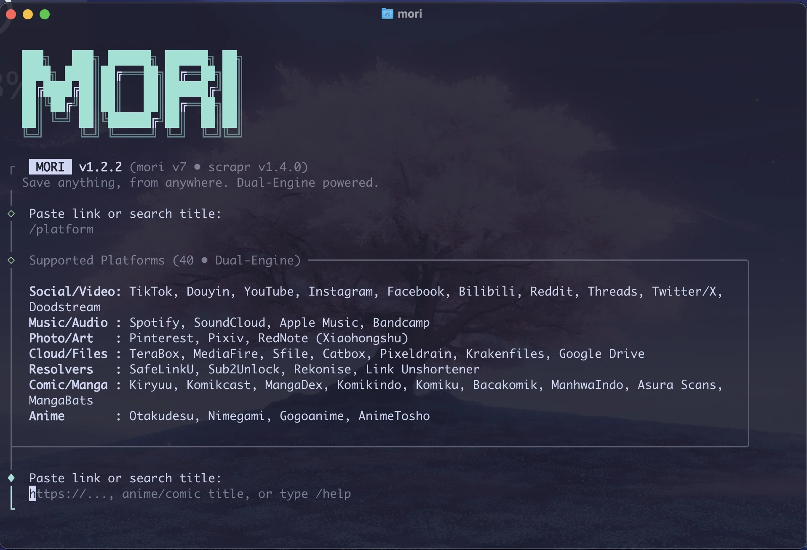

<p align="center">
  <h1 align="center">@coflyn/mori</h1>
  <p align="center"><strong>Universal Media Downloader CLI</strong></p>
  <p align="center"><em>Save anything, from anywhere. No watermarks. No tracking.</em></p>
  <p align="center"><strong>English</strong> · <a href="translations/README-zh-CN.md">简体中文</a> · <a href="translations/README-id.md">Bahasa Indonesia</a></p>
</p>

<p align="center">
  <a href="https://www.npmjs.com/package/@coflyn/mori"></a>
  <a href="https://www.npmjs.com/package/@coflyn/mori"></a>
  <a href="https://github.com/coflyn/Mori"></a>
  <a href="https://github.com/coflyn/Mori"></a>
</p>

<p align="center">
  
</p>

---

Command-line interface for **[Mori](https://github.com/coflyn/Mori)**. Download watermark-free videos, photos, audio, full playlists, and compile photo galleries into PDF files across 27 platforms directly from your terminal.

## Quick Start

Run directly without global installation:

```bash
# Interactive REPL mode
npx @coflyn/mori

# Download a link directly
npx @coflyn/mori "https://www.tiktok.com/@user/video/123456789"

# Download audio only (MP3)
npx @coflyn/mori "https://youtu.be/dQw4w9WgXcQ" -a

# Download an entire playlist or album automatically
npx @coflyn/mori "https://www.youtube.com/playlist?list=PLxxx" -y

# Compile photo carousel into a single PDF
npx @coflyn/mori "https://www.instagram.com/p/C_abc123/" -p
```

Or install globally:

```bash
npm install -g @coflyn/mori
mori
```

---

## Supported Platforms

| Category | Platforms | Supported Media |
| :--- | :--- | :--- |
| **Social & Video** | TikTok, Douyin, YouTube, Instagram, Facebook, Twitter/X, Threads, Reddit, Bilibili, Doodstream | Videos without watermarks, 1080p streams, photo posts, stories, audio |
| **Music & Audio** | Spotify, YouTube, SoundCloud, Apple Music, Bandcamp | Single tracks, full albums, discographies, playlists (MP3 128–320 kbps) |
| **Images & Art** | Pinterest, Pixiv, RedNote (Xiaohongshu) | High-resolution images, original illustration galleries, Ugoira animations |
| **Cloud & File Hosts** | TeraBox, MediaFire, Sfile, Catbox, Pixeldrain, Krakenfiles, Google Drive | Direct stream resolution, batch links, multi-file collections |
| **Resolvers & Shorteners** | SafeLinkU, Sub2Unlock, Rekonise, Stargon / Link bypassers | Gateway bypass to final media destinations |
| **Anime & Manga** | Otakudesu, Gogoanime, Komikindo, Komiku, Asura Scans | In-CLI title search, episode stream extraction, comic chapter PDF compilation |

---

## CLI Options

```text
USAGE:
  mori [URL] [OPTIONS]
  npx @coflyn/mori [URL] [OPTIONS]

OPTIONS:
  -o, --output <dir>              Download directory (default: ~/Downloads/Mori)
  -e, --engine <auto|mori|scrapr> Scraper engine selector (default: auto)
  -s, --server <1|2>              Select server mirror (TikTok, IG, YouTube, X, Spotify)
  -a, --audio                     Download audio stream only (MP3/M4A)
  -p, --pdf                       Compile photo galleries into a single PDF document
  -c, --clip                      Download link copied to system clipboard
  -y, --yes                       Download without prompts (auto-selects best stream or all playlist tracks)
  -i, --info                      Inspect media details and stream list without downloading
  -u, --update                    Check for package updates and OTA scraper patches
  -h, --help                      Show help and usage guide
  -v, --version                   Show version number
```

---

## Interactive Shell & Slash Commands

Running `mori` with no arguments starts the interactive prompt. Type a URL or title to start, or use `/` commands:

| Command | Aliases | Description |
| :--- | :--- | :--- |
| `/clip` | `/paste` | Read and download URL from system clipboard |
| `/audio [url]` | `/mp3` | Download audio stream only (MP3/M4A) |
| `/pdf [url]` | — | Compile photo carousel into a single PDF album |
| `/batch` | — | Download multiple links at once (space or newline separated) |
| `/play [num]` | — | Open downloaded file in your default system media player |
| `/history [num]` | — | View history, re-download an item, or clear (`/history clear`) |
| `/delete` | `/del`, `/rm` | Interactive multiselect deletion (remove from history or delete from disk) |
| `/open` | — | Open Mori download folder in Finder or File Explorer |
| `/dir [path]` | — | View or change default download directory |
| `/server` | — | Change default scraper server mirror |
| `/engine` | — | Switch between Mori Engine, Scrapr Engine, or Auto mode |
| `/rollback` | — | Revert scraper engine to an earlier commit or release |
| `/info [url]` | `/inspect` | Print stream details without downloading |
| `/retry` | `/again` | Re-run last processed download |
| `/ping [host]` | — | Ping network host to test connection (default: 1.1.1.1) |
| `/stats` | — | Show total downloads, storage used, and platform statistics |
| `/platforms` | `/platform` | List all 27 supported platforms |
| `/config` | — | Print active configuration, directory paths, and versions |
| `/update` | `/u` | Check for npm CLI updates and OTA scraper patches from GitHub |
| `/reset` | — | Reset Mori configuration and history to defaults |
| `/clear` | `/cls` | Clear terminal screen |
| `/help` | `/?` | Display commands reference |
| `/exit` | `/quit`, `/q` | Exit CLI |

---

## Technical Details

- **Dual-Engine Architecture**: Mori uses an internal core scraper bundle and can fall back to the standalone Scrapr engine when upstream sites change their layouts.
- **OTA Patching**: Scraper logic can update via GitHub commits without waiting for a new npm release. Run `/update` or `/rollback` to manage versions.
- **Playlist & Album Queue**: Pasting a YouTube playlist, Spotify album, or Apple Music collection shows track numbers and titles, letting you download everything sequentially or pick individual tracks.
- **Local Storage**: Configuration and history stay on your machine in `~/.mori`. No analytics or telemetry.

---

## License

Licensed under the [GNU General Public License v3.0](https://github.com/coflyn/Mori/blob/main/LICENSE).  
Part of the **[Mori](https://github.com/coflyn/Mori)** project.
