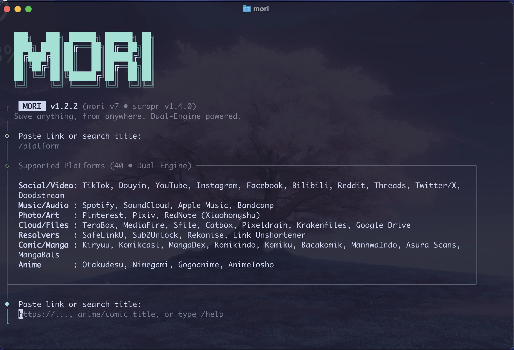

<p align="center">
  <h1 align="center">@coflyn/mori</h1>
  <p align="center"><strong>CLI Downloader Media Universal</strong></p>
  <p align="center"><em>Download media apa saja, dari mana saja. Tanpa watermark. Tanpa pelacak.</em></p>
  <p align="center"><a href="../README.md">English</a> · <a href="README-zh-CN.md">简体中文</a> · <strong>Bahasa Indonesia</strong></p>
</p>

<p align="center">
  <a href="https://www.npmjs.com/package/@coflyn/mori"></a>
  <a href="https://www.npmjs.com/package/@coflyn/mori"></a>
  <a href="https://github.com/coflyn/Mori"></a>
  <a href="https://github.com/coflyn/Mori"></a>
</p>

<p align="center">
  
</p>

---

Antarmuka baris perintah (CLI) untuk **[Mori](https://github.com/coflyn/Mori)**. Download video tanpa watermark, foto beresolusi penuh, audio, seluruh isi playlist, serta satukan galeri foto menjadi file PDF dari 27 platform langsung lewat terminal.

## Cara Pakai Cepat

Jalankan langsung tanpa perlu install global lewat `npx`:

```bash
# Mode interaktif (REPL)
npx @coflyn/mori

# Download link langsung
npx @coflyn/mori "https://www.tiktok.com/@user/video/123456789"

# Download audio saja (MP3)
npx @coflyn/mori "https://youtu.be/dQw4w9WgXcQ" -a

# Download semua lagu di playlist atau album sekaligus
npx @coflyn/mori "https://www.youtube.com/playlist?list=PLxxx" -y

# Kompilasi postingan multi-foto menjadi satu file PDF
npx @coflyn/mori "https://www.instagram.com/p/C_abc123/" -p
```

Atau pasang secara global di perangkat:

```bash
npm install -g @coflyn/mori
mori
```

---

## Platform yang Didukung

| Kategori | Platform | Format yang Didukung |
| :--- | :--- | :--- |
| **Media Sosial & Video** | TikTok, Douyin, YouTube, Instagram, Facebook, Twitter/X, Threads, Reddit, Bilibili, Doodstream | Video bebas watermark, stream 1080p, postingan foto/slide, story, audio |
| **Musik & Audio** | Spotify, YouTube, SoundCloud, Apple Music, Bandcamp | Single track, album penuh, diskografi, playlist (MP3 128–320 kbps) |
| **Gambar & Ilustrasi** | Pinterest, Pixiv, RedNote (Xiaohongshu) | Gambar resolusi asli, galeri ilustrasi, animasi Ugoira |
| **Cloud & File Hosting** | TeraBox, MediaFire, Sfile, Catbox, Pixeldrain, Krakenfiles, Google Drive | Resolusi link langsung, batch link, album koleksi banyak file |
| **Shortener & Resolver** | SafeLinkU, Sub2Unlock, Rekonise, Stargon / Link bypasser | Bypass gateway menuju link file asli |
| **Anime & Manga** | Otakudesu, Gogoanime, Komikindo, Komiku, Asura Scans | Pencarian judul langsung dari CLI, stream episode, kompilasi chapter komik ke PDF |

---

## Opsi Perintah (Flags)

```text
PENGGUNAAN:
  mori [URL] [OPSI]
  npx @coflyn/mori [URL] [OPSI]

OPSI:
  -o, --output <folder>           Tentukan folder download (default: ~/Downloads/Mori)
  -e, --engine <auto|mori|scrapr> Pilih engine scraper (default: auto)
  -s, --server <1|2>              Pilih mirror server (TikTok, IG, YouTube, X, Spotify)
  -a, --audio                     Ambil stream audio saja (MP3/M4A)
  -p, --pdf                       Kompilasi postingan multi-foto jadi 1 file PDF
  -c, --clip                      Ambil dan download link dari clipboard sistem
  -y, --yes                       Download otomatis tanpa konfirmasi (ambil kualitas terbaik atau seluruh playlist)
  -i, --info                      Lihat metadata dan daftar stream tanpa mendownload
  -u, --update                    Cek pembaruan paket dan patch OTA scraper
  -h, --help                      Buka panduan bantuan
  -v, --version                   Tampilkan nomor versi
```

---

## Shell Interaktif & Perintah Slash

Menjalankan `mori` tanpa argumen akan membuka antarmuka terminal interaktif. Masukkan link atau judul anime/komik untuk mulai, atau gunakan perintah berawalan `/`:

| Perintah | Alias | Penjelasan |
| :--- | :--- | :--- |
| `/clip` | `/paste` | Ambil dan download link yang ada di clipboard |
| `/audio [url]` | `/mp3` | Download stream audio saja (MP3/M4A) |
| `/pdf [url]` | — | Gabungkan galeri foto menjadi satu file PDF |
| `/batch` | — | Download banyak tautan sekaligus (dipisah spasi atau baris baru) |
| `/play [nomor]` | — | Putar file hasil download di pemutar media bawaan komputer |
| `/history [nomor]` | — | Lihat riwayat download, download ulang, atau hapus riwayat (`/history clear`) |
| `/delete` | `/del`, `/rm` | Hapus riwayat download secara interaktif (bisa sekalian hapus file di disk) |
| `/open` | — | Buka folder hasil download di Finder atau File Explorer |
| `/dir [path]` | — | Cek atau ubah lokasi folder download default |
| `/server` | — | Ganti server mirror scraper default |
| `/engine` | — | Ganti mode engine (Mori Engine, Scrapr Engine, atau Auto) |
| `/rollback` | — | Kembalikan engine scraper ke versi atau commit sebelumnya |
| `/info [url]` | `/inspect` | Tampilkan detail stream tanpa mendownload file |
| `/retry` | `/again` | Download ulang link yang terakhir diproses |
| `/ping [host]` | — | Uji latensi jaringan dan paket hilang (default: 1.1.1.1) |
| `/stats` | — | Tampilkan statistik download, kuota disk terpakai, dan ringkasan per platform |
| `/platforms` | `/platform` | Tampilkan daftar 27 platform yang didukung |
| `/config` | — | Lihat konfigurasi aktif, lokasi penyimpanan, dan versi engine |
| `/update` | `/u` | Cek pembaruan CLI di npm dan patch OTA scraper dari GitHub |
| `/reset` | — | Kembalikan pengaturan dan riwayat Mori ke setelan awal |
| `/clear` | `/cls` | Bersihkan layar terminal |
| `/help` | `/?` | Tampilkan ringkasan perintah |
| `/exit` | `/quit`, `/q` | Keluar dari CLI |

---

## Detail Teknis

- **Arsitektur Dual-Engine**: Mori memakai modul scraper internal dan otomatis beralih ke engine Scrapr jika struktur halaman platform target berubah.
- **Pembaruan OTA (Over-The-Air)**: Logika scraper bisa diperbarui lewat commit GitHub tanpa harus menunggu rilis paket baru di npm. Gunakan `/update` atau `/rollback` untuk mengatur versi.
- **Antrean Playlist & Album**: Menempelkan playlist YouTube, album Spotify, atau daftar lagu Apple Music akan memunculkan nomor serta judul lagu asli. Kamu bisa memilih download semua secara berurutan atau hanya lagu tertentu.
- **Penyimpanan Lokal**: Seluruh konfigurasi dan riwayat download tersimpan di perangkat kamu (`~/.mori`). Tidak ada telemetri maupun analitik.

---

## Lisensi

Didistribusikan di bawah [Lisensi GNU General Public License v3.0](https://github.com/coflyn/Mori/blob/main/LICENSE).  
Bagian dari proyek **[Mori](https://github.com/coflyn/Mori)**.
