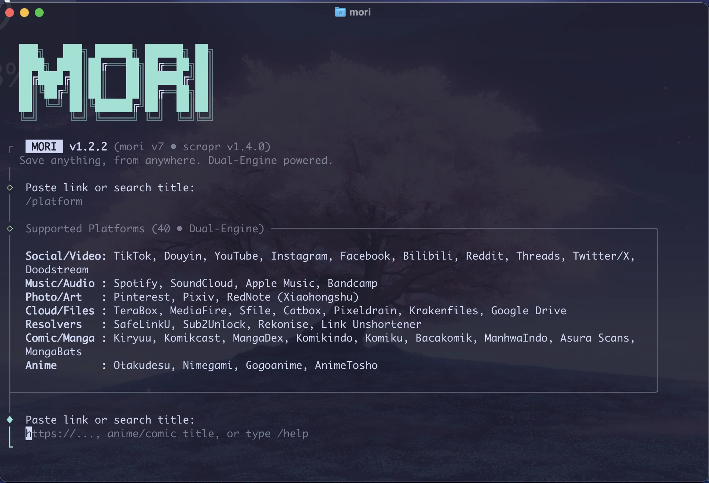

<p align="center">
  <h1 align="center">@coflyn/mori</h1>
  <p align="center"><strong>通用多媒体下载 CLI</strong></p>
  <p align="center"><em>随处保存，想下就下。无水印，无追踪。</em></p>
  <p align="center"><a href="../README.md">English</a> · <strong>简体中文</strong> · <a href="README-id.md">Bahasa Indonesia</a></p>
</p>

<p align="center">
  <a href="https://www.npmjs.com/package/@coflyn/mori"></a>
  <a href="https://www.npmjs.com/package/@coflyn/mori"></a>
  <a href="https://github.com/coflyn/Mori"></a>
  <a href="https://github.com/coflyn/Mori"></a>
</p>

<p align="center">
  
</p>

---

**[Mori](https://github.com/coflyn/Mori)** 命令行工具。直接在终端中从 27 个主流平台下载无水印视频、高清原图、音频、整张播放列表，或将图集拼合编译为单份 PDF 文档。

## 快速上手

通过 `npx` 直接运行，无需全局安装：

```bash
# 启动交互式终端模式 (REPL)
npx @coflyn/mori

# 直接下载指定链接
npx @coflyn/mori "https://www.tiktok.com/@user/video/123456789"

# 仅提取音频 (MP3)
npx @coflyn/mori "https://youtu.be/dQw4w9WgXcQ" -a

# 自动下载整张播放列表或专辑
npx @coflyn/mori "https://www.youtube.com/playlist?list=PLxxx" -y

# 将多图贴文合并为单份 PDF
npx @coflyn/mori "https://www.instagram.com/p/C_abc123/" -p
```

或者进行全局安装：

```bash
npm install -g @coflyn/mori
mori
```

---

## 支持的平台

| 分类 | 平台 | 支持的内容 |
| :--- | :--- | :--- |
| **社交与视频** | TikTok, 抖音, YouTube, Instagram, Facebook, Twitter/X, Threads, Reddit, 哔哩哔哩, Doodstream | 无水印视频、1080p 画质流、图片贴文、快拍、原声音频 |
| **音乐与音频** | Spotify, YouTube, SoundCloud, Apple Music, Bandcamp | 单曲、整张专辑、全集唱片、歌单播放列表 (MP3 128–320 kbps) |
| **插画与图集** | Pinterest, Pixiv, 小红书 (RedNote) | 高清原图、插画画廊、动图 Ugoira |
| **网盘与文件存储** | TeraBox, MediaFire, Sfile, Catbox, Pixeldrain, Krakenfiles, Google 云端硬盘 | 直链解析、批量下载、多文件合集 |
| **短链与跳板解析** | SafeLinkU, Sub2Unlock, Rekonise, Stargon / 网页跳转解析器 | 绕过中转页直接获取目标资源 |
| **动漫与漫画** | Otakudesu, Gogoanime, Komikindo, Komiku, Asura Scans | 终端内搜索番剧漫画、剧集流媒体解析、漫画章节导出 PDF |

---

## 命令行参数 (Options)

```text
用法:
  mori [URL] [参数]
  npx @coflyn/mori [URL] [参数]

参数:
  -o, --output <目录>             自定义下载目录 (默认: ~/Downloads/Mori)
  -e, --engine <auto|mori|scrapr> 解析引擎选择 (默认: auto)
  -s, --server <1|2>              选择服务器镜像 (TikTok, IG, YouTube, X, Spotify)
  -a, --audio                     仅提取并下载音频流 (MP3/M4A)
  -p, --pdf                       将多图贴文合并编译为单份 PDF 电子书
  -c, --clip                      自动读取系统剪贴板中的链接并开始下载
  -y, --yes                       无需确认直接下载 (自动选择最佳画质或下载整份播放列表)
  -i, --info                      仅查看媒体详情与可用画质流，不执行下载
  -u, --update                    检查包更新及 OTA 爬虫热补丁
  -h, --help                      显示帮助与使用指南
  -v, --version                   显示版本号
```

---

## 交互模式与斜杠命令

不带任何参数运行 `mori` 将进入交互式 Shell。输入链接或搜索词开始，或使用 `/` 开头的内置命令：

| 命令 | 别名 | 功能说明 |
| :--- | :--- | :--- |
| `/clip` | `/paste` | 读取系统剪贴板并下载其中的多媒体链接 |
| `/audio [url]` | `/mp3` | 仅提取并下载音频流 (MP3/M4A) |
| `/pdf [url]` | — | 将图片画廊或贴文合并为单份 PDF |
| `/batch` | — | 批量下载多个链接 (空格或换行分隔) |
| `/play [序号]` | — | 在系统默认播放器中打开并播放已下载的音视频 |
| `/history [序号]` | — | 查看下载历史、重新下载或清空历史 (`/history clear`) |
| `/delete` | `/del`, `/rm` | 交互式多选删除 (可选择仅移除历史记录或同时删除本地文件) |
| `/open` | — | 在访达 (Finder) 或文件资源管理器中打开下载目录 |
| `/dir [路径]` | — | 查看或永久修改默认下载目录 |
| `/server` | — | 切换默认爬虫镜像服务器 |
| `/engine` | — | 在 Mori 引擎、Scrapr 引擎或自动模式间切换 |
| `/rollback` | — | 将解析引擎回滚至指定历史提交或版本 |
| `/info [url]` | `/inspect` | 打印媒体详细参数与流列表，不执行下载 |
| `/retry` | `/again` | 重新下载上次处理的链接 |
| `/ping [主机]` | — | 测试网络延迟与丢包率 (默认: 1.1.1.1) |
| `/stats` | — | 查看已下载文件总数、磁盘占用及各平台统计 |
| `/platforms` | `/platform` | 列出全部 27 个支持的平台与服务 |
| `/config` | — | 查看当前配置、存储路径与版本号 |
| `/update` | `/u` | 检查 npm 模块更新及来自 GitHub 的 OTA 爬虫补丁 |
| `/reset` | — | 将所有配置与下载历史恢复至出厂默认状态 |
| `/clear` | `/cls` | 清屏并重新打印终端标识 |
| `/help` | `/?` | 显示命令参考手册 |
| `/exit` | `/quit`, `/q` | 退出交互模式 |

---

## 技术细节

- **双引擎架构**: 优先使用轻量内置解析核心；当目标网站页面改版时，自动回退到独立的 Scrapr 引擎。
- **OTA 热补丁机制**: 当平台接口变动时，解析逻辑可直接通过 GitHub 提交在线更新，无需等待发布新的 npm 版本。使用 `/update` 或 `/rollback` 随时管理引擎版本。
- **播放列表与专辑队列**: 粘贴 YouTube 播放列表、Spotify 专辑或 Apple Music 歌单时，终端将完整识别曲目编号与歌名，支持整单顺序下载或选择指定歌曲。
- **纯本地存储**: 配置文件与下载历史均保存在本地 `~/.mori` 中，不含任何追踪代码与数据埋点。

---

## 开源协议

遵循 [GNU General Public License v3.0](https://github.com/coflyn/Mori/blob/main/LICENSE) 开源协议。  
属于 **[Mori](https://github.com/coflyn/Mori)** 项目的一部分。
