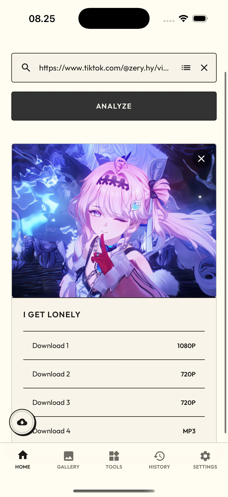
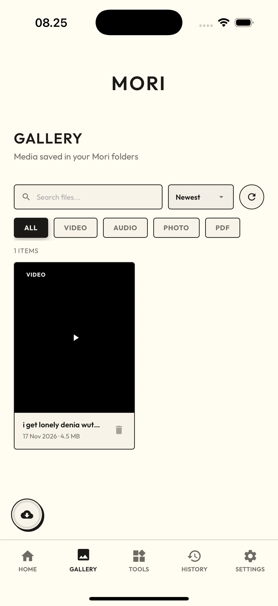
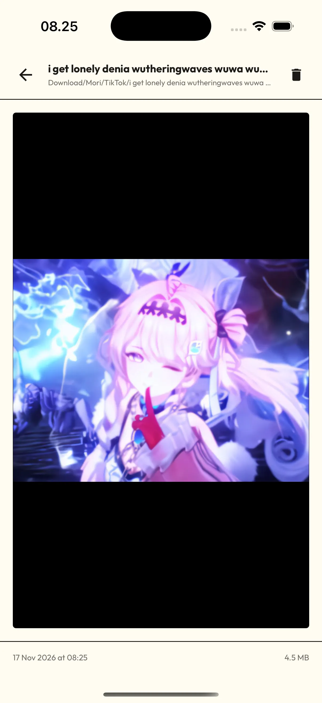
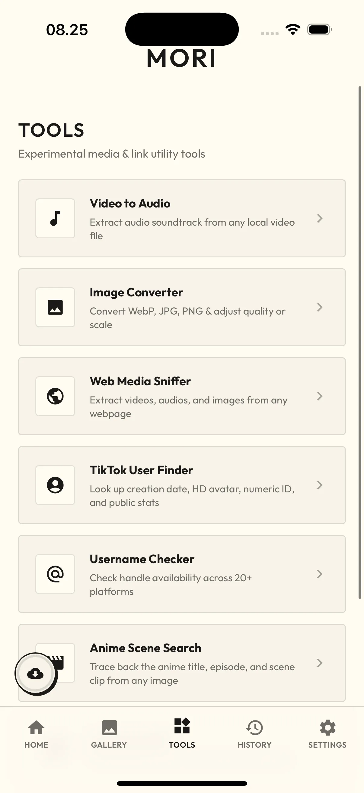
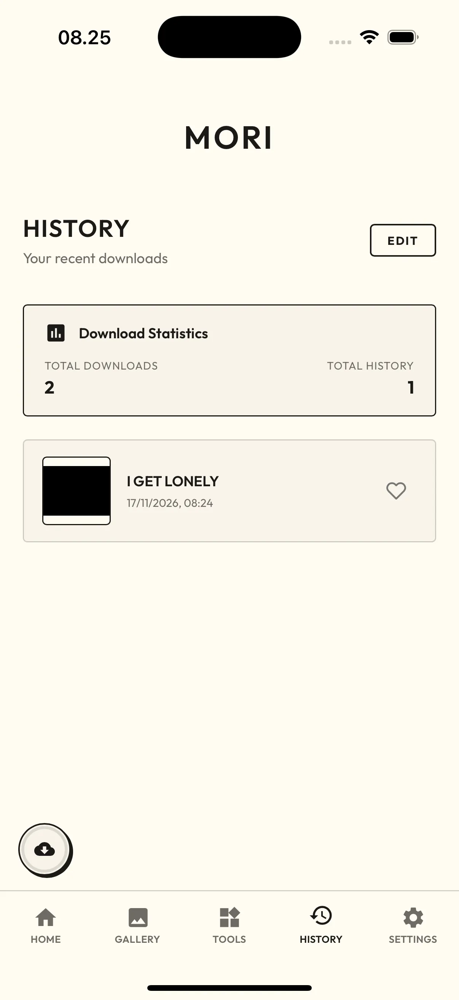
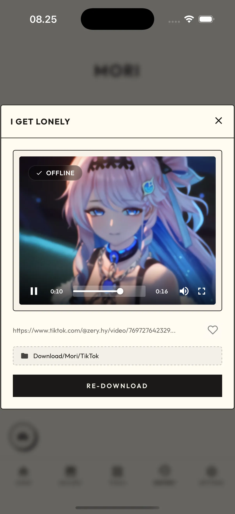
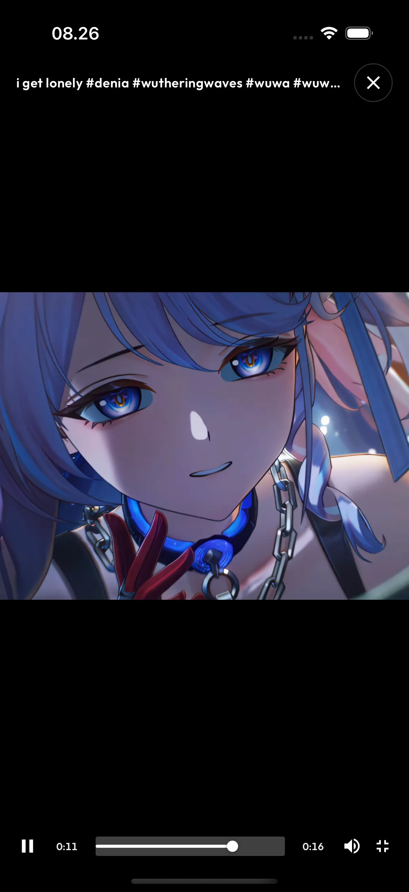
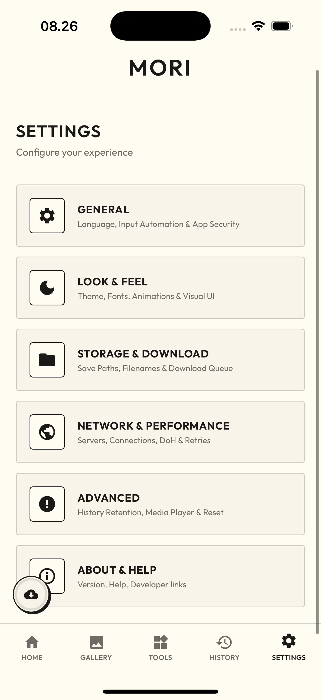
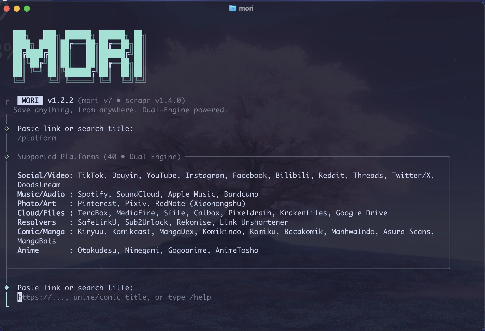

<p align="center">
  
</p>

<h1 align="center">Mori</h1>
<p align="center"><em>Guarda cualquier contenido, desde cualquier lugar.</em></p>
<p align="center"><a href="../README.md">English</a> · <a href="README-zh-CN.md">简体中文</a> · <a href="README-id.md">Bahasa Indonesia</a> · <strong>Español</strong></p>

<p align="center">
  
  <a href="https://www.npmjs.com/package/@coflyn/mori"></a>
  
  
  
  
  
  <a href="https://whatsapp.com/channel/0029VbDXoqs6mYPSVp4UcT2A"></a>
</p>

<div align="center">

Descarga vídeos, fotos y audio de 16 plataformas con herramientas multimedia integradas. Sin marcas de agua, cuentas ni rastreo. Todo se procesa localmente en tu dispositivo.

<a href="https://sociabuzz.com/coflyn/tribe" target="_blank">
  
</a>

</div>

## Capturas de pantalla

<p align="center">
  
  
  
  
</p>
<p align="center">
  
  
  
  
</p>

---

## Tabla de contenidos

1. [Modo de uso](#modo-de-uso)
2. [Descarga e instalación](#descarga-e-instalación)
3. [Mori CLI (Terminal)](#mori-cli-terminal)
4. [Características](#características)
5. [Herramientas integradas](#herramientas-integradas)
6. [Plataformas compatibles y motores de extracción](#plataformas-compatibles-y-motores-de-extracción)
7. [Para desarrolladores y compilación](#para-desarrolladores-y-compilación)
8. [Arquitectura del motor de extracción](#arquitectura-del-motor-de-extracción)
9. [Aviso legal](#aviso-legal)
10. [Licencia](#licencia)

---

## Modo de uso

Descarga contenido multimedia en tres pasos:

1. Copia el enlace de un vídeo, foto o música desde cualquier aplicación compatible.
2. Abre Mori. La aplicación detecta el portapapeles automáticamente. En Android, también puedes presionar Compartir en cualquier publicación y elegir Mori.
3. Selecciona la calidad o formato y presiona Descargar. Los archivos se guardan directamente en tu galería o carpeta de música.

## Descarga e instalación

Los paquetes precompilados están disponibles en [GitHub Releases](https://github.com/coflyn/Mori/releases) y [npm](https://www.npmjs.com/package/@coflyn/mori).

| Plataforma | Paquete | Guía |
| :--- | :--- | :--- |
|  Android | `Mori v...apk` | [Guía de instalación y Play Protect](GUIDE-es.md#instalación-en-android-y-solución-de-problemas) |
|  iOS | `Mori v...ipa` | [Instalación con AltStore / TrollStore](GUIDE-es.md#guía-de-instalación-en-ios-sideloading) |
|  CLI (Escritorio y Servidor) | `npx @coflyn/mori`<br>`npm install -g @coflyn/mori` | [Guía de Mori CLI](#mori-cli-terminal) |

> Para conocer los pasos detallados de instalación y resolución de errores, consulta la [Guía de usuario (GUIDE-es.md)](GUIDE-es.md).

> Nota: Las aplicaciones de escritorio tradicionales con interfaz gráfica fueron reemplazadas por Mori CLI (`@coflyn/mori`), lo que permite un uso directo desde la terminal y actualizaciones más sencillas sin bloqueos de seguridad del sistema operativo.

---

## Mori CLI (Terminal)

Mori también se ejecuta directamente en la terminal:

<p align="center">
  
</p>

```bash
# Ejecutar directamente sin instalar
npx @coflyn/mori

# Descargar cualquier enlace directamente
npx @coflyn/mori <URL>

# Descargar solo audio (MP3)
npx @coflyn/mori <URL> -a

# Convertir álbum de fotos directamente a PDF
npx @coflyn/mori <URL> -p
```

O instalar de forma global:

```bash
npm install -g @coflyn/mori
mori
```

Características del CLI:
- Menú interactivo con navegación por flechas y comandos rápidos (`/history`, `/play <num>`, `/delete <num>`, `/config`, `/stats`, `/update`, `/clear`).
- Verificación automática de versión al iniciar que te avisa cuando hay una actualización disponible en npm.
- Descarga concurrente de carruseles de fotos y álbumes con barras de progreso en tiempo real.
- Actualizaciones directas desde la terminal con `mori --update` o `/update`.
- Consulta la [documentación del CLI (cli/README.md)](../cli/README.md) para ver la lista completa de comandos y argumentos.

## Características

- Descarga vídeos, fotos y audios sin marcas de agua de 16 plataformas (TikTok, Instagram, YouTube, Twitter/X, Spotify, Apple Music, Pinterest, Facebook, Threads, Bandcamp, Pixiv, Bilibili, Douyin, RedNote, Reddit, TeraBox).
- Reconocimiento de enlaces de discos en la nube chinos (Quark, UC, Baidu, Xunlei, 115, 123, Lanzou, Aliyun, etc.), conservando el enlace y código de extracción (Mori no descarga estos servidores directamente aún).
- Herramientas multimedia integradas: navegador con captura de transmisiones, extractor de audio sin conexión, conversor de imágenes, compresor de PDF, verificador de nombres de usuario y buscador de escenas de anime.
- Actualizaciones directas de la APK desde la aplicación a través de GitHub Releases con registro de cambios traducido.
- Plantillas de nombres de archivo personalizables con `{platform}`, `{date}`, `{time}`, `{quality}`, `{num}` y `{title}`, con contadores secuenciales independientes por plataforma.
- Progreso de descarga en tiempo real con contador de bytes, velocidad de transferencia, detección de cortes y estado de escritura en disco.
- Indexación automática en MediaStore para que los archivos aparezcan al instante en la galería y reproductores del sistema.
- Carpeta de descarga configurable, con soporte para tarjetas SD externas.
- Descarga de álbumes completos y listas de reproducción para Spotify, Apple Music y YouTube.
- Descargas paralelas de hasta 5 procesos simultáneos para álbumes y carruseles.
- Burbuja flotante de descarga con anillo de progreso general, lista de tareas y controles de cancelación.
- Integración con el menú Compartir de Android para descargar sin necesidad de abrir la aplicación principal.
- Descargador por lotes para procesar múltiples enlaces en cola.
- Reproductor multimedia integrado con barra de reproducción, avance con doble toque y control de audio.
- Galería multimedia interna para ver y filtrar vídeos, música, fotos y archivos PDF guardados.
- Conversión de carruseles de fotos a documentos PDF para lectura sin conexión.
- Bloqueo opcional por PIN o biometría para el historial y los ajustes.
- Descargas en segundo plano con soporte de bloqueo de suspensión (wake-lock).
- Disponible en 10 idiomas (inglés, indonesio, japonés, coreano, chino simplificado, árabe con diseño RTL, ruso, tagalo, hindi y español).
- Funciona 100% en el dispositivo, sin cuentas, anuncios ni recopilación de datos.

---

## Herramientas integradas

La pestaña Herramientas ofrece utilidades locales que se ejecutan directamente en tu dispositivo:

| Herramienta | Tipo | Descripción |
| :--- | :--- | :--- |
| Capturador de medios | Inspector de red | Navegador integrado que detecta transmisiones de vídeo, audio y HLS (.m3u8), bloqueando publicidad y rastreadores. |
| Extractor de vídeo a audio | Utilidad local | Convierte vídeos locales (MP4, MKV, WebM, MOV) a audio WAV o MP3 mediante la Web Audio API. |
| Conversor y escalador de imágenes | Utilidad local | Convierte y redimensiona imágenes entre WebP, JPG y PNG con control de calidad y resolución. |
| Compresor de documentos PDF | Utilidad local | Reduce el tamaño de archivos PDF directamente en el dispositivo usando pdf-lib y pdf.js, con tres niveles de compresión. |
| Verificador de nombres de usuario | Consulta | Comprueba la disponibilidad de un alias en más de 20 redes sociales de forma simultánea. |
| Buscador de escenas de anime | Consulta | Búsqueda inversa de capturas de anime a través de trace.moe para identificar título, número de episodio y minuto exacto. |
| Consulta de perfiles de TikTok | Consulta | Muestra información pública, estadísticas, cantidad de seguidores y foto de perfil. |
| Resolvedor de enlaces acortados | Resolvedor de URL | Extrae el enlace final a partir de acortadores y pasarelas de publicidad compatibles. |

---

## Plataformas compatibles y motores de extracción

| Plataforma | Dominios y formatos compatibles | Funciones | Motor de extracción / Proveedor |
| :--- | :--- | :--- | :--- |
|  Instagram | `instagram.com` (`/p/`, `/reel/`, `/stories/`) | Reels / Historias / Fotos | InDown (`indown.net`) y SnapSave (`snapsave.app`) |
|  TikTok | `tiktok.com`, `vt.tiktok.com` | Vídeo (sin marca de agua) / Fotos deslizables | TikDownloader (`tikdownloader.io`) y TikTokIO (`tiktokio.com`) |
|  YouTube | `youtube.com`, `youtu.be`, `music.youtube.com` | Listas / Álbumes / MP4 / MP3 | Ytmp3.gg (`media.ytmp3.gg`) y Ytmp3.gl (`ytmp3.gl`) |
|  Twitter (X) | `twitter.com`, `x.com` | Vídeo en alta definición / GIFs | TwitterVideoDownloader (`twittervideodownloader.com`) y SaveTWT (`savetwt.com`) |
|  Spotify | `open.spotify.com` (`track`, `album`, `playlist`, `/s/`) | Listas / Álbumes / MP3 | SpotiDown (`spotidown.app`) y SoundLoaders (`spotimate.app`) |
|  Apple Music | `music.apple.com` | Álbum / Lista de reproducción / Pista MP3 | AplMate (`aplmate.com`) |
|  Pinterest | `pinterest.com`, `pin.it` | Vídeos / Imágenes en alta definición | Extractor directo de `pinimg.com` y PinDown (`pindown.io`) |
|  Facebook | `facebook.com`, `fb.watch` | Reels / Vídeo en alta definición | SnapSave (`snapsave.app`) |
|  RedNote | `xiaohongshu.com`, `xhslink.com`, `xhslink.cn`, `rednote.com` | Fotos y vídeos en alta definición | Extractor directo de SSR `__INITIAL_STATE__` |
|  Threads | `threads.com` | Vídeo / Carrusel de fotos | Threadster (`threadster.app`) |
|  Bilibili | `bilibili.com`, `b23.tv`, `bili.im`, `bilibili.tv` | Vídeo / Audio (DASH 1080p) | API web directa de Bilibili (`api.bilibili.com` y `api.bilibili.tv`) y resolvedor Wbi |
|  Pixiv | `pixiv.net` (`artworks`) | Galería / Conversión de Ugoira a MP4 | API AJAX directa de Pixiv y conversor Ugoira Zip a MP4 |
|  Douyin | `douyin.com`, `v.douyin.com` | Vídeo (sin marca de agua) / Fotos | API directa de `iesdouyin.com` y resolvedor SSR multimarcador |
|  Bandcamp | `*.bandcamp.com` | Canción / Álbum / MP3 | BandcampDownloader (`bandcampdownloader.app`) |
|  Reddit | `reddit.com`, `redd.it` | Vídeo en alta definición con audio / Fotos | RapidSave (`rapidsave.com`) |
|  TeraBox | `terabox.com`, `teraboxapp.com`, `1024tera.com`, `teraboxlink` | Archivo directo / Transmisión (m3u8) | Sechno (`sechno.com`) |

---

## Para desarrolladores y compilación

Para configurar el entorno de desarrollo, contribuir con traducciones o compilar el proyecto:

- Consulta [CONTRIBUTING.md](../CONTRIBUTING.md) para conocer los requisitos y comandos de compilación en Android e iOS.
- Consulta [CHANGELOG.md](../CHANGELOG.md) para revisar el historial de versiones.

---

## Arquitectura del motor de extracción

Los extractores están empaquetados en `public/js/scrapers/bundle.js` mediante esbuild como un IIFE que incluye las 16 plataformas compatibles.

- El código compilado se distribuye con cada actualización de la aplicación a través de GitHub Releases.
- La interfaz, la capa de puente y los controladores de extracción son de código abierto bajo la licencia GPL-3.0.
- Si deseas corregir o actualizar un extractor, revisa las instrucciones en [CONTRIBUTING.md](../CONTRIBUTING.md).

---

## Aviso legal

- Uso personal y educativo: Mori está diseñado para el archivo personal de medios e investigación. Los usuarios son responsables de cumplir con las leyes de derechos de autor de su jurisdicción y los términos de servicio de cada plataforma.
- Sin alojamiento de archivos: Mori no aloja, almacena en caché ni redistribuye archivos multimedia en servidores propios. Todas las descargas se realizan directamente en el dispositivo del usuario.
- Servicios externos: Mori consulta puntos de acceso web públicos. Si administras un servicio externo y deseas solicitar la exclusión de un endpoint, abre un issue en GitHub o escribe a riazrepo@gmail.com.

---

## Licencia

Mori está protegido bajo la [Licencia Pública General de GNU v3.0 (GPL-3.0)](../LICENSE).

- Cualquier modificación o redistribución de este software debe publicarse con el código fuente completo bajo la misma licencia GPL-3.0.
- No se permite la redistribución comercial, el cambio de marca o la publicación de versiones cerradas de Mori sin cumplir con los términos de la GPL-3.0.
- El nombre y logotipo de Mori pertenecen al autor original. Los proyectos derivados deben utilizar una identidad gráfica diferente.

---

## Historial de Estrellas

<p align="center">
  <a href="https://star-history.com/#coflyn/Mori&Date">
    
  </a>
</p>

---

Desarrollado por coflyn.  
Canal de WhatsApp: https://whatsapp.com/channel/0029VbDXoqs6mYPSVp4UcT2A  
GitHub: https://github.com/coflyn  
Instagram: @\_coflyn
