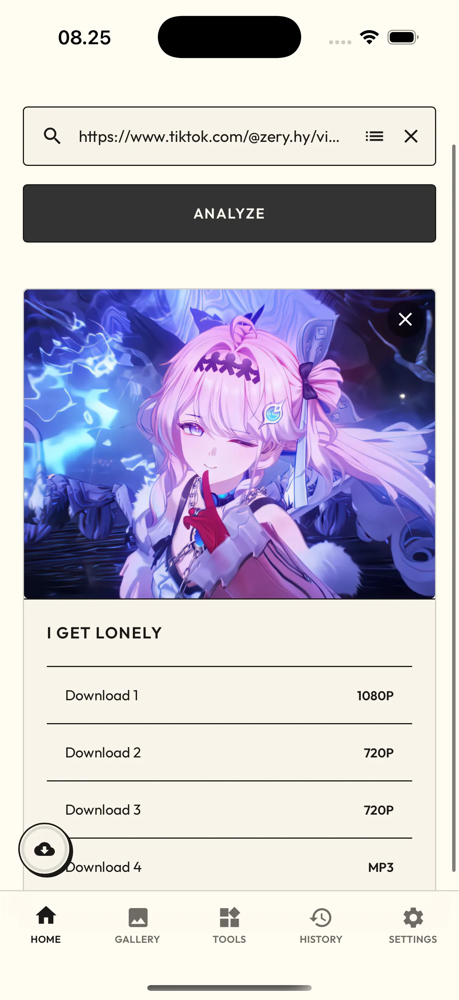
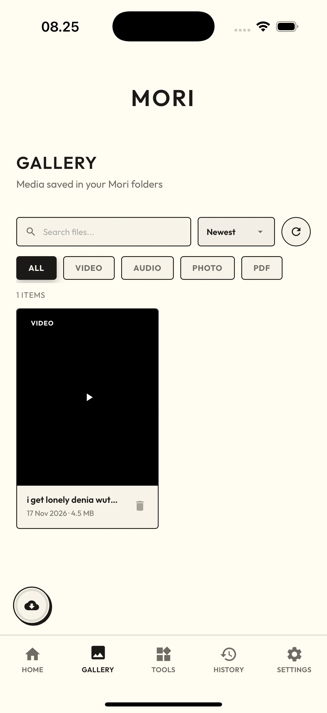
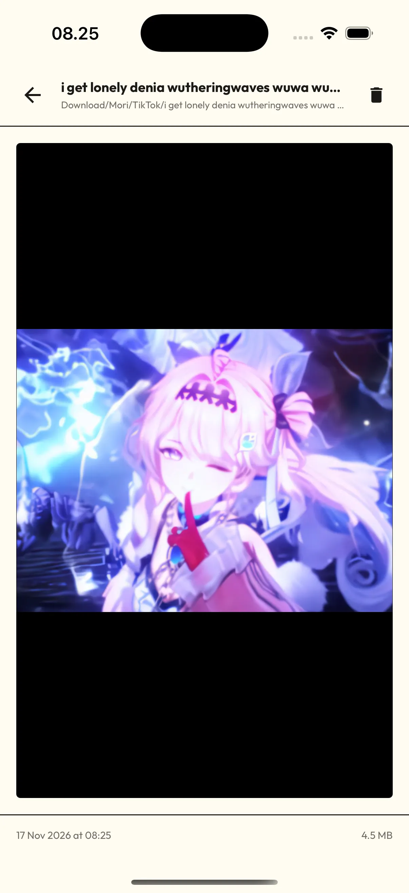
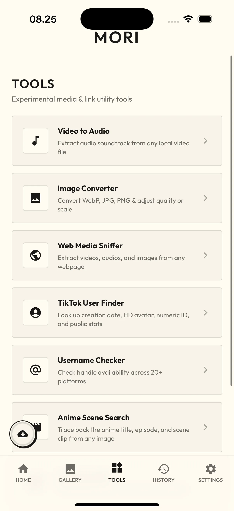
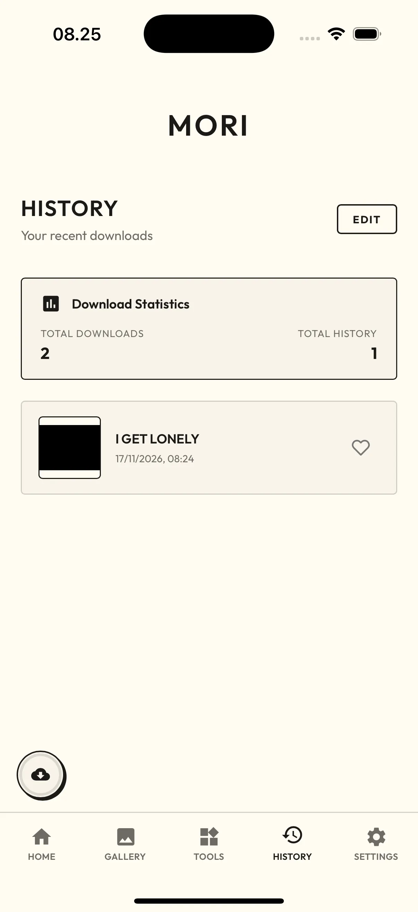
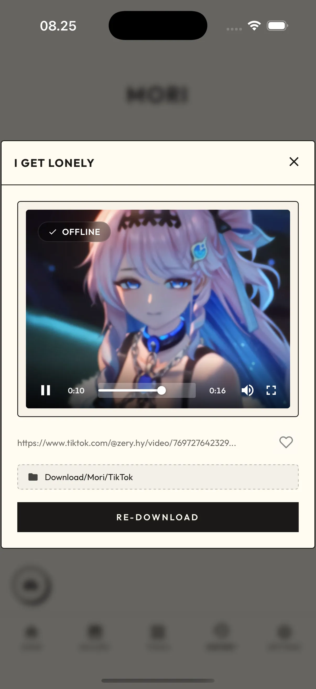
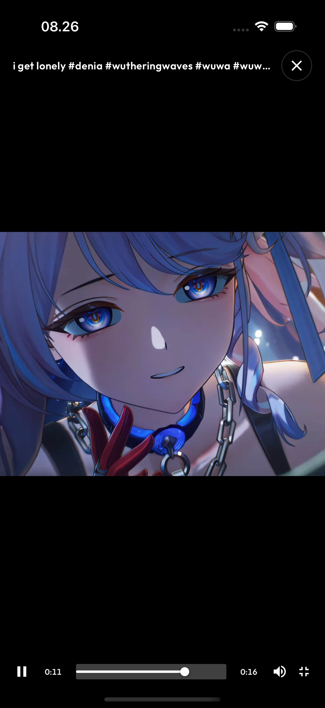
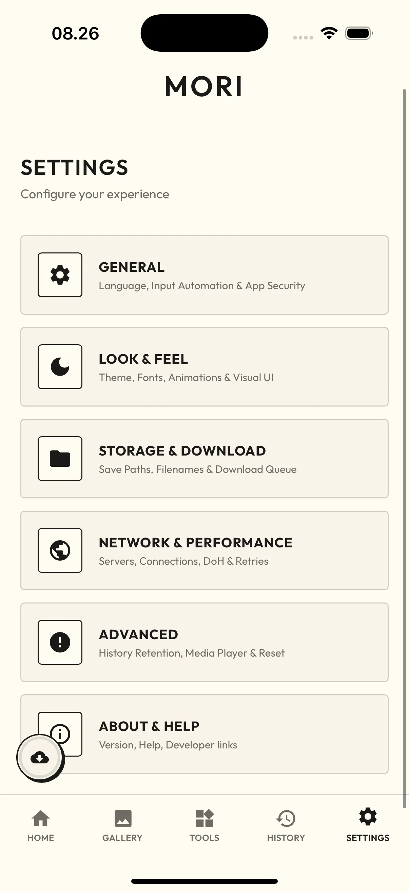
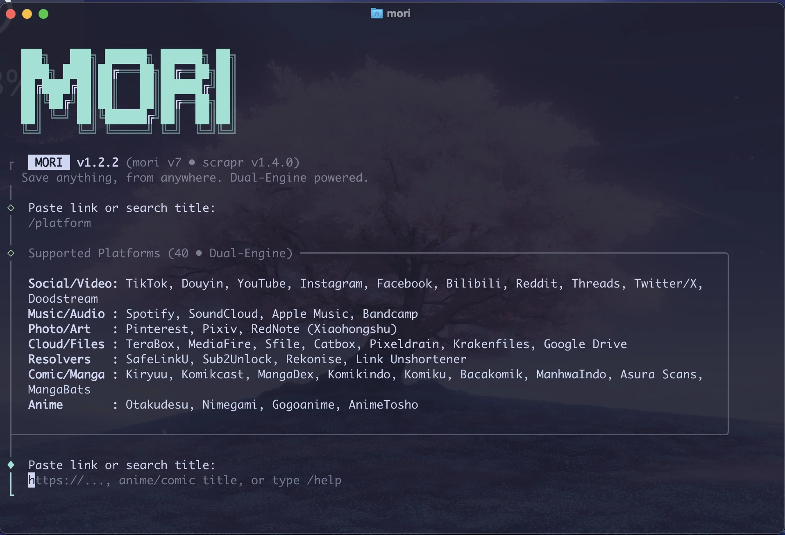

<p align="center">
  
</p>

<h1 align="center">Mori</h1>
<p align="center"><em>Download media apa saja, dari mana saja.</em></p>
<p align="center"><a href="../README.md">English</a> · <a href="README-zh-CN.md">简体中文</a> · <strong>Bahasa Indonesia</strong> · <a href="README-es.md">Español</a></p>

<p align="center">
  
  <a href="https://www.npmjs.com/package/@coflyn/mori"></a>
  
  
  
  
  
  <a href="https://whatsapp.com/channel/0029VbDXoqs6mYPSVp4UcT2A"></a>
</p>

<div align="center">

Download video, foto, dan audio dari 16 platform tanpa watermark, tanpa login akun, dan tanpa pelacak. Dilengkapi berbagai tools media bawaan dan semuanya jalan langsung di perangkat kamu.

<a href="https://sociabuzz.com/coflyn/tribe" target="_blank">
  
</a>

</div>

## Tangkapan Layar

<p align="center">
  
  
  
  
</p>
<p align="center">
  
  
  
  
</p>

---

## Daftar Isi

1. [Cara Pakai](#cara-pakai)
2. [Download dan Instalasi](#download-dan-instalasi)
3. [Mori CLI (Terminal)](#mori-cli-terminal)
4. [Fitur](#fitur)
5. [Tools Bawaan](#tools-bawaan)
6. [Platform yang Didukung](#platform-yang-didukung)
7. [Buat Developer & Build Sendiri](#buat-developer--build-sendiri)
8. [Arsitektur Scraper](#arsitektur-scraper)
9. [Disclaimer](#disclaimer)
10. [Lisensi](#lisensi)

---

## Cara Pakai

Download media cuma butuh 3 langkah:

1. Salin link video, foto, atau lagu dari aplikasi medsos mana saja yang didukung.
2. Buka Mori. Aplikasi bakal otomatis mendeteksi link dari clipboard. Di Android, kamu juga bisa langsung klik tombol **Share** di postingan lalu pilih **Mori**.
3. Pilih resolusi atau format yang dimau, lalu klik **Download**. File langsung tersimpan di galeri atau folder musik HP kamu.

## Download dan Instalasi

File instalasi resmi tersedia di [GitHub Releases](https://github.com/coflyn/Mori/releases) dan [npm](https://www.npmjs.com/package/@coflyn/mori).

| Platform | File / Perintah | Panduan |
| :--- | :--- | :--- |
|  Android | `Mori v...apk` | [Panduan Instalasi & Play Protect](GUIDE-id.md#instalasi-android--troubleshooting) |
|  iOS | `Mori v...ipa` | [Sideload via AltStore / TrollStore](GUIDE-id.md#panduan-sideload-ios) |
|  CLI (Desktop & Server) | `npx @coflyn/mori`<br>`npm install -g @coflyn/mori` | [Panduan Mori CLI](#mori-cli-terminal) |

> Buat langkah instalasi detail dan solusi kendala, cek [Buku Panduan (GUIDE-id.md)](GUIDE-id.md).

> Catatan: Aplikasi desktop GUI digantikan oleh Mori CLI (`@coflyn/mori`) agar bisa langsung dipanggil lewat terminal dan update lebih gampang tanpa terhambat peringatan keamanan OS.

---

## Mori CLI (Terminal)

Mori juga bisa dijalankan langsung dari terminal desktop:

<p align="center">
  
</p>

```bash
# Jalankan langsung tanpa install
npx @coflyn/mori

# Download link langsung
npx @coflyn/mori <URL>

# Download audio saja (MP3)
npx @coflyn/mori <URL> -a

# Gabungkan album foto langsung jadi file PDF
npx @coflyn/mori <URL> -p
```

Atau install global biar bisa dipanggil dari mana saja:

```bash
npm install -g @coflyn/mori
mori
```

Fitur CLI:
- Tampilan interaktif dengan navigasi tombol panah dan slash commands (`/history`, `/play <nomor>`, `/delete <nomor>`, `/config`, `/stats`, `/update`, `/clear`).
- Otomatis cek update versi baru dari npm tiap kali dijalankan.
- Download paralel untuk album foto/carousel lengkap dengan progress bar.
- Update versi CLI langsung lewat `mori --update` atau `/update`.
- Perintah dan opsi lengkapnya bisa dilihat di [Dokumentasi CLI (cli/README.md)](../cli/README.md).

## Fitur

- Download video, foto, dan audio bebas watermark dari 16 platform (TikTok, Instagram, YouTube, Twitter/X, Spotify, Apple Music, Pinterest, Facebook, Threads, Bandcamp, Pixiv, Bilibili, Douyin, RedNote, Reddit, TeraBox).
- Dukungan link cloud drive (Quark, UC, Baidu, Xunlei, 115, 123, Lanzou, Aliyun, dll.): Mori bakal merapikan link dan otomatis menyimpan kode akses (`pwd`).
- Beragam tools media bawaan: live browser sniffer, ekstraktor audio offline, konverter gambar, kompresor PDF, cek ketersediaan username, dan pencarian adegan anime.
- Update aplikasi APK langsung dari dalam aplikasi via GitHub Releases lengkap dengan changelog lokal.
- Template nama file bebas diatur (`{platform}`, `{date}`, `{time}`, `{quality}`, `{num}`, `{title}`) dengan nomor urut yang rapi.
- Pantau progres download real-time: indikator bytes, kecepatan transfer, deteksi download nyangkut, dan status penyimpanan.
- Pengindeksan otomatis ke MediaStore Android biar file langsung muncul di galeri foto atau pemutar musik.
- Bebas pilih folder penyimpanan kustom, termasuk ke kartu memori micro SD eksternal.
- Download satu album dan playlist penuh sekaligus buat Spotify, Apple Music, dan YouTube.
- Download paralel hingga 5 antrean sekaligus untuk album dan carousel foto.
- Floating download bubble dengan ring progres, daftar antrean, dan tombol batalkan.
- Integrasi menu Share Android buat download cepat tanpa harus keluar dari medsos.
- Mode batch buat antrekan banyak link sekaligus.
- Pemutar media bawaan lengkap dengan pencarian linimasa, tap ganda buat maju/mundur, dan kontrol audio.
- Galeri media lokal buat memutar dan menyaring video, musik, foto, dan PDF yang sudah didownload.
- Simpan carousel foto langsung jadi file PDF buat dibaca offline.
- Kunci keamanan tambahan dengan PIN atau sidik jari/Face ID untuk riwayat dan pengaturan.
- Download tetap jalan di latar belakang (background) dengan proteksi wake-lock.
- Tersedia dalam 10 bahasa (Inggris, Indonesia, Jepang, Korea, Mandarin Sederhana, Arab dengan tata letak RTL, Rusia, Tagalog, Hindi, Spanyol).
- Berjalan 100% lokal di perangkat kamu tanpa akun, iklan, ataupun pelacak.

---

## Tools Bawaan

Tab Tools menyediakan berbagai alat praktis yang berjalan langsung di perangkat kamu:

| Tools | Jenis | Fungsi |
| :--- | :--- | :--- |
| Media Sniffer | Sniffer Jaringan | Browser khusus dalam aplikasi buat menangkap link stream video, audio, dan HLS (.m3u8) sambil otomatis memblokir iklan dan pelacak. |
| Video to Audio Extractor | Utilitas Offline | Mengambil audio dari video lokal (MP4, MKV, WebM, MOV) dan mengubahnya jadi WAV atau MP3 via Web Audio API. |
| Image Converter & Scaler | Utilitas Offline | Mengonversi dan mengubah ukuran gambar antarformat WebP, JPG, dan PNG lengkap dengan slider kualitas dan resolusi. |
| PDF Document Compressor | Utilitas Offline | Memperkecil ukuran file PDF secara offline memakai pdf-lib dan pdf.js bawaan dengan 3 pilihan preset kompresi. |
| Username Checker | Pencarian | Mengecek ketersediaan username di lebih dari 20 platform sosial media sekaligus. |
| Anime Scene Search | Pencarian | Mencari judul anime, nomor episode, dan menit adegan dari potongan gambar screenshot memakai trace.moe. |
| TikTok Profile Lookup | Pencarian | Melihat informasi akun publik, statistik, jumlah followers, dan download foto profil HD. |
| Shortlink Resolver | Pengurai Link | Membuka dan mengekstrak link tujuan asli dari pemendek link dan gateway iklan yang didukung. |

---

## Platform yang Didukung

| Platform | Domain / Format yang Didukung | Fitur | Mesin Scraper / Penyedia |
| :--- | :--- | :--- | :--- |
|  Instagram | `instagram.com` (`/p/`, `/reel/`, `/stories/`) | Reels / Stories / Foto | InDown (`indown.net`) & SnapSave (`snapsave.app`) |
|  TikTok | `tiktok.com`, `vt.tiktok.com` | Video (Tanpa WM) / Slide Foto | TikDownloader (`tikdownloader.io`) & TikTokIO (`tiktokio.com`) |
|  YouTube | `youtube.com`, `youtu.be`, `music.youtube.com` | Playlist / Album / MP4 / MP3 | Ytmp3.gg (`media.ytmp3.gg`) & Ytmp3.gl (`ytmp3.gl`) |
|  Twitter (X) | `twitter.com`, `x.com` | Video HD / GIF | TwitterVideoDownloader (`twittervideodownloader.com`) & SaveTWT (`savetwt.com`) |
|  Spotify | `open.spotify.com` (`track`, `album`, `playlist`, `/s/`) | Playlist / Album / Lagu MP3 | SpotiDown (`spotidown.app`) & SoundLoaders (`spotimate.app`) |
|  Apple Music | `music.apple.com` | Album / Playlist / Lagu MP3 | AplMate (`aplmate.com`) |
|  Pinterest | `pinterest.com`, `pin.it` | Video / Gambar HD | Parser langsung `pinimg.com` & PinDown (`pindown.io`) |
|  Facebook | `facebook.com`, `fb.watch` | Reels / Video HD | SnapSave (`snapsave.app`) |
|  RedNote | `xiaohongshu.com`, `xhslink.com`, `xhslink.cn`, `rednote.com` | Foto HD / Video | Ekstraktor langsung SSR `__INITIAL_STATE__` |
|  Threads | `threads.com` | Video / Carousel Foto | Threadster (`threadster.app`) |
|  Bilibili | `bilibili.com`, `b23.tv`, `bili.im`, `bilibili.tv` | Video / Audio (DASH 1080p) | Web API Bilibili (`api.bilibili.com` & `api.bilibili.tv`) & Wbi Resolver |
|  Pixiv | `pixiv.net` (`artworks`) | Galeri / Ugoira ke MP4 | AJAX API Pixiv & Konverter Ugoira Zip-ke-MP4 |
|  Douyin | `douyin.com`, `v.douyin.com` | Video (Tanpa WM) / Foto | API langsung `iesdouyin.com` & Multi-Marker SSR Resolver |
|  Bandcamp | `*.bandcamp.com` | Lagu / Album / MP3 | BandcampDownloader (`bandcampdownloader.app`) |
|  Reddit | `reddit.com`, `redd.it` | Video HD (Audio) / Foto | RapidSave (`rapidsave.com`) |
|  TeraBox | `terabox.com`, `teraboxapp.com`, `1024tera.com`, `teraboxlink` | File Langsung / Stream (m3u8) | Sechno (`sechno.com`) |

---

## Buat Developer & Build Sendiri

Kalau kamu mau setup environment koding, bantu terjemahan bahasa, atau build aplikasinya sendiri:

- Baca [CONTRIBUTING.md](../CONTRIBUTING.md) buat panduan setup dan langkah kompilasi untuk Android dan iOS.
- Baca [CHANGELOG.md](../CHANGELOG.md) buat catatan riwayat rilis.

---

## Arsitektur Scraper

Semua scraper dibundel ke file `public/js/scrapers/bundle.js` memakai esbuild dalam format IIFE yang mencakup mesin untuk 16 platform.

- Bundle scraper otomatis diperbarui lewat rilis reguler di GitHub Releases.
- Tampilan UI, bridge native, dan wrapper scraper bersifat open source di bawah lisensi GPL-3.0.
- Perbaikan atau penambahan scraper platform baru bisa diajukan dengan mengikuti panduan di [CONTRIBUTING.md](../CONTRIBUTING.md).

---

## Disclaimer

- **Penggunaan pribadi dan edukasi**: Mori ditujukan untuk arsip media pribadi dan riset. Pengguna bertanggung jawab penuh untuk mematuhi hak cipta dan ketentuan layanan dari masing-masing platform.
- **Bukan penyedia hosting file**: Mori tidak menyimpan atau mendistribusikan ulang file media apa pun di server luar. Semua download ditarik langsung dari penyedia asli ke perangkat pengguna.
- **Layanan pihak ketiga**: Mori mengambil data dari endpoint web publik. Jika kamu pemilik layanan terkait dan ingin endpoint dihapus, silakan buka GitHub Issue atau hubungi riazrepo@gmail.com.

---

## Lisensi

Mori dilisensikan di bawah [GNU General Public License v3.0 (GPL-3.0)](../LICENSE).

- Siapa pun yang memodifikasi atau mendistribusikan ulang software ini wajib menyertakan kode sumber lengkap di bawah lisensi GPL-3.0.
- Dilarang menjual ulang secara komersial, mengganti branding tanpa izin, atau mendistribusikan build tertutup (closed-source) tanpa mematuhi ketentuan GPL-3.0.
- Nama dan logo Mori adalah hak cipta pembuat aslinya. Proyek turunan wajib memakai branding yang berbeda.

---

## Riwayat Bintang

<p align="center">
  <a href="https://star-history.com/#coflyn/Mori&Date">
    
  </a>
</p>

---

Dibuat oleh coflyn.  
Saluran WhatsApp: https://whatsapp.com/channel/0029VbDXoqs6mYPSVp4UcT2A  
GitHub: https://github.com/coflyn  
Instagram: @\_coflyn
